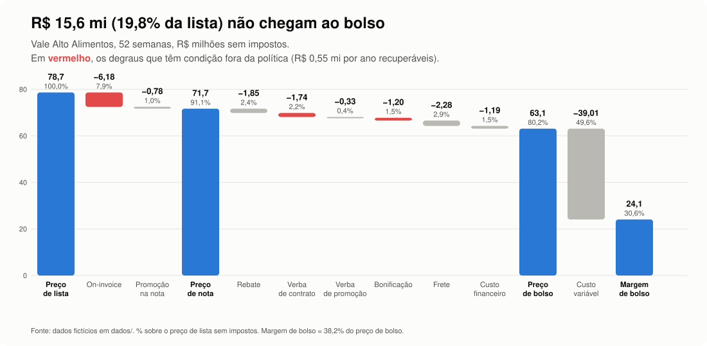

# rgm-skills-br

> **EN.** Revenue Growth Management skills for consumer goods in Brazil, packaged as a Claude Code plugin: price waterfall, promotion ROI, price-pack architecture, and pricing under Brazil's 2026-2033 tax reform (CBS/IBS). Ships with a fictional CPG company's dataset and an end-to-end case. Content in Portuguese.

Skills de **Revenue Growth Management** para bens de consumo no Brasil, em um plugin para Claude Code. O pacote inclui quatro análises que um time de RGM faz toda semana, os dados de uma indústria fictícia e um caso resolvido do começo ao fim.

| Skill | Pergunta de negócio | Status |
|---|---|---|
| `price-waterfall` | Onde a margem vaza entre o preço de lista e o preço de bolso? | pronta · [caso](caso/01-price-waterfall.md) |
| `preco-cbs-ibs` | Quanto repassar, por canal e por ano, na transição da reforma? | em construção |
| `retorno-promocao` | Esta promoção se paga ou só antecipa e canibaliza venda? | em construção |
| `price-pack-architecture` | A escada de preço por tamanho faz sentido? Onde há lacuna? | em construção |

## Instalação
No Claude Code:
```
/plugin marketplace add pedrocardosojr/rgm-skills-br
/plugin install rgm-br@rgm-skills-br
```

## Dados de exemplo
A pasta [`dados/`](dados/) tem 52 semanas da **Vale Alto Alimentos**, uma empresa fictícia com café, biscoito e refrigerante, 9 SKUs, 4 canais e 27 promoções. O [dicionário](dados/DICIONARIO.md) explica cada arquivo. Para regerar os dados: `python3 scripts/gerar_dados.py`.

## Caso
As quatro análises aplicadas à Vale Alto, cada uma com o número-chave, os gráficos e as recomendações em R$.

[](caso/01-price-waterfall.md)

1. [Price waterfall](caso/01-price-waterfall.md): R$ 15,6 mi (19,8%) da lista não chegam ao bolso, e R$ 0,84 mi por ano são recuperáveis.
2. Preço com CBS/IBS (em construção)
3. Retorno de promoção (em construção)
4. Price-pack architecture (em construção)

## Aviso
Números e regras tributárias são ilustrativos. Isto não é parecer fiscal. Antes de qualquer decisão real, confira a LC 214/2025 e a legislação do seu estado.

## Licença
[MIT](LICENSE) © 2026 Pedro Cardoso Jr
