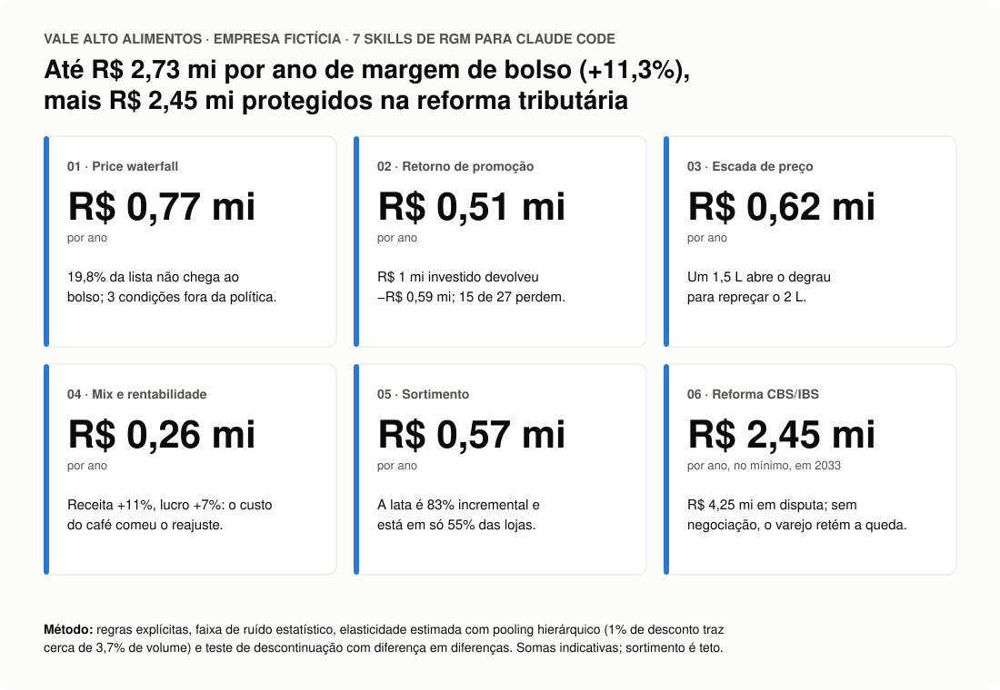
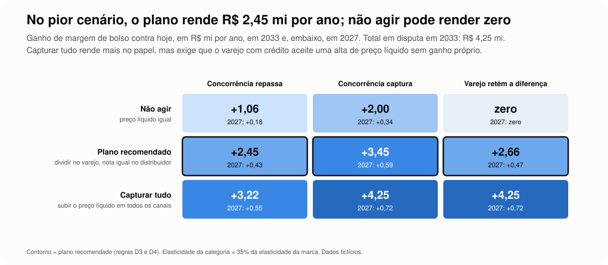
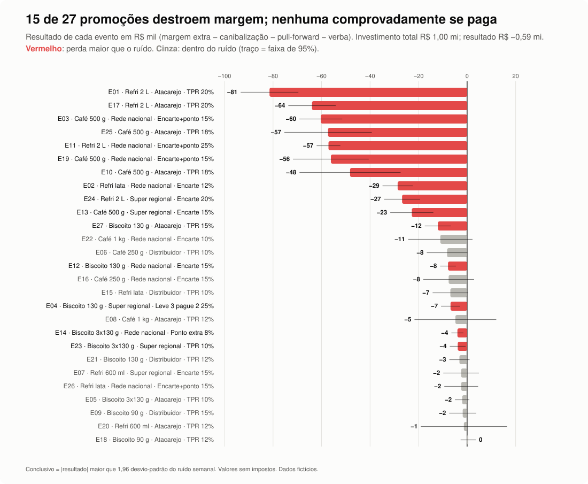
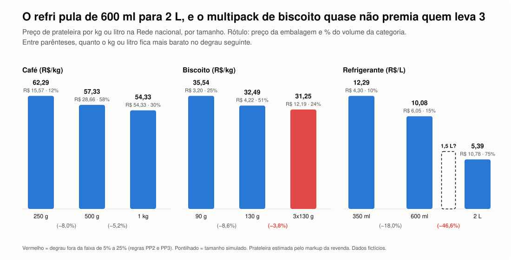
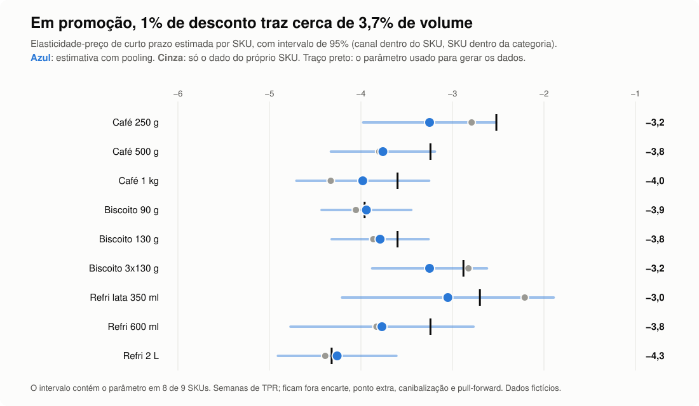
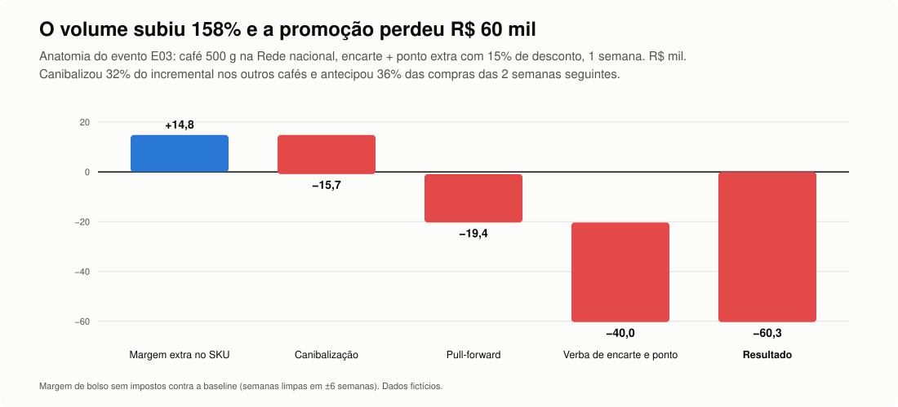
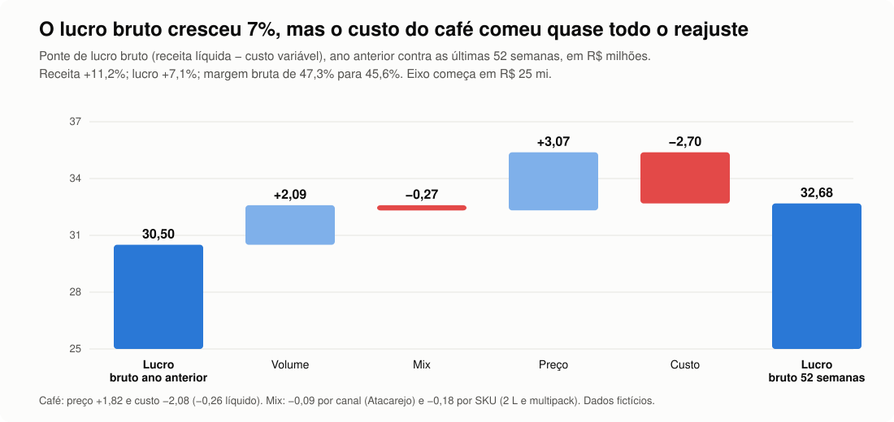
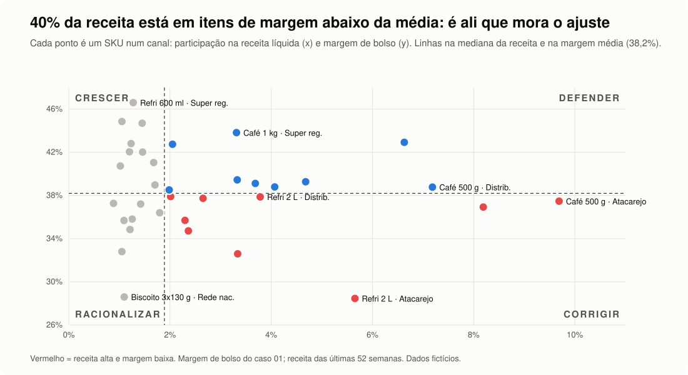
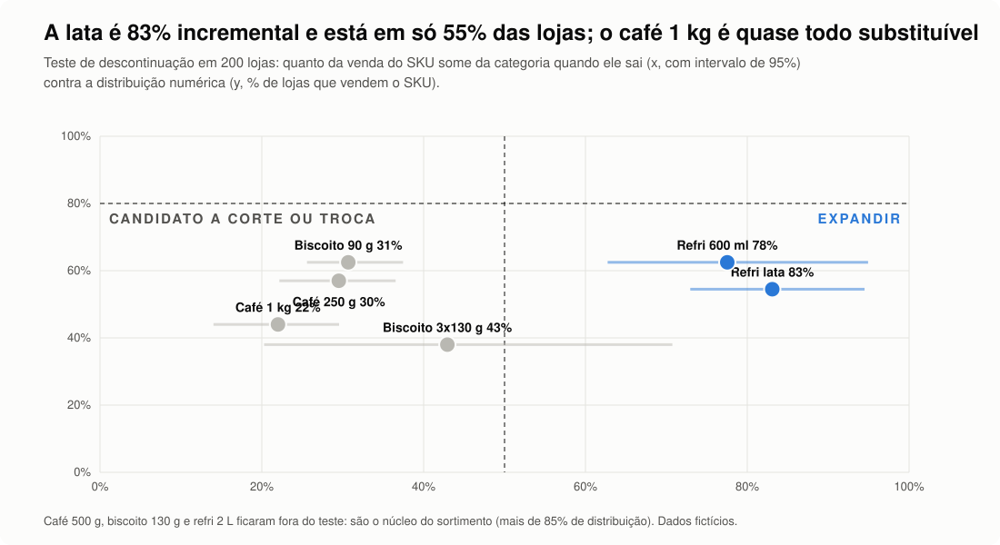

# rgm-skills-br

> **EN.** Revenue Growth Management skills for consumer goods in Brazil, packaged as a Claude Code plugin: price waterfall, promotion ROI, price-pack architecture, price elasticity estimation, price-volume-mix and ABC analysis, assortment and demand transfer, and pricing under Brazil's 2026-2033 tax reform (CBS/IBS). Ships with a fictional CPG company's dataset and an end-to-end case. Content in Portuguese.

[](#caso)

Skills de **Revenue Growth Management** para bens de consumo no Brasil, em um plugin para Claude Code. O pacote inclui sete análises que um time de RGM faz toda semana, os dados de uma indústria fictícia e um caso resolvido do começo ao fim.

| Skill | Pergunta de negócio | Status |
|---|---|---|
| `price-waterfall` | Onde a margem vaza entre o preço de lista e o preço de bolso? | pronta · [caso](caso/01-price-waterfall.md) |
| `preco-cbs-ibs` | Quanto repassar, por canal e por ano, na transição da reforma? | pronta · [caso](caso/02-preco-cbs-ibs.md) |
| `retorno-promocao` | Esta promoção se paga ou só antecipa e canibaliza venda? | pronta · [caso](caso/03-retorno-promocao.md) |
| `price-pack-architecture` | A escada de preço por tamanho faz sentido? Onde há lacuna? | pronta · [caso](caso/04-price-pack-architecture.md) |
| `elasticidade-preco` | Quanto o volume reage a 1% de desconto, e quanto disso o dado sustenta? | pronta · [caso](caso/05-elasticidade.md) |
| `mix-rentabilidade` | A receita cresceu: por que o lucro não acompanhou, e em que itens agir? (PVM, curva ABC, matriz) | pronta · [caso](caso/06-mix-rentabilidade.md) |
| `sortimento` | Quanto de cada SKU é venda nova? Onde expandir, trocar ou cortar? | pronta · [caso](caso/07-sortimento.md) |

## Instalação
No Claude Code:
```
/plugin marketplace add pedrocardosojr/rgm-skills-br
/plugin install rgm-br@rgm-skills-br
```

## Dados de exemplo
A pasta [`dados/`](dados/) tem 52 semanas da **Vale Alto Alimentos**, uma empresa fictícia com café, biscoito e refrigerante, 9 SKUs, 4 canais e 27 promoções. O [dicionário](dados/DICIONARIO.md) explica cada arquivo. Para regerar os dados: `python3 scripts/gerar_dados.py`. Para reestimar a elasticidade: `python3 scripts/estimar_elasticidade.py` (requer numpy). Os dados de ano anterior e de sell-out por loja (200 lojas, com teste de descontinuação) vêm de `python3 scripts/gerar_dados_mix_sortimento.py`.

## Caso
As sete análises aplicadas à Vale Alto, cada uma com o número-chave, os gráficos e as recomendações em R$. Somadas, valem **até R$ 2,73 mi por ano de margem de bolso (+11,3%)**, mais R$ 2,45 mi protegidos na reforma.

1. [Price waterfall](caso/01-price-waterfall.md): R$ 15,6 mi (19,8%) da lista não chegam ao bolso, e R$ 0,77 mi por ano são recuperáveis.
2. [Preço com CBS/IBS](caso/02-preco-cbs-ibs.md): R$ 4,25 mi por ano ficam em disputa em 2033, e o plano garante pelo menos R$ 2,45 mi em qualquer cenário.
3. [Retorno de promoção](caso/03-retorno-promocao.md): R$ 1,00 mi investido devolveu −R$ 0,59 mi; 15 de 27 eventos destroem margem com segurança estatística.
4. [Price-pack architecture](caso/04-price-pack-architecture.md): lançar o 1,5 L e subir o 2 L vale R$ 0,48 mi por ano; baixar o multipack perderia R$ 143 mil.
5. [Elasticidade estimada](caso/05-elasticidade.md): em promoção, 1% de desconto traz cerca de 3,7% de volume; o pooling hierárquico recupera o parâmetro em 8 de 9 SKUs.
6. [Mix e rentabilidade](caso/06-mix-rentabilidade.md): receita +11,2%, lucro bruto +7,1%; o custo do café comeu o reajuste (−R$ 0,26 mi) e o mix tirou R$ 0,27 mi.
7. [Sortimento](caso/07-sortimento.md): a lata é 83% incremental e está em 55% das lojas; expandir lata e 600 ml vale até R$ 0,57 mi por ano.

| | |
|---|---|
| [](caso/01-price-waterfall.md) | [](caso/02-preco-cbs-ibs.md) |
| [](caso/03-retorno-promocao.md) | [](caso/04-price-pack-architecture.md) |
| [](caso/05-elasticidade.md) | [](caso/03-retorno-promocao.md) |
| [](caso/06-mix-rentabilidade.md) | [](caso/06-mix-rentabilidade.md) |
| [](caso/07-sortimento.md) | |

## Contexto de mercado
O caso é conservador contra o mercado: 56% das promoções destroem margem, e a Nielsen achou cerca de 75%. Os números de mercado, as ferramentas que a área usa e as fontes estão em [docs/contexto-mercado.md](docs/contexto-mercado.md).

## Para usar na sua empresa
- [Checklist de dados mínimos](docs/checklist-dados.md): o que cada skill precisa, em que grão e onde o dado costuma estar.
- [Glossário de RGM em português e inglês](docs/glossario.md).

## Aviso
Números e regras tributárias são ilustrativos. Isto não é parecer fiscal. Antes de qualquer decisão real, confira a LC 214/2025 e a legislação do seu estado.

## Licença
[MIT](LICENSE) © 2026 Pedro Cardoso Jr
