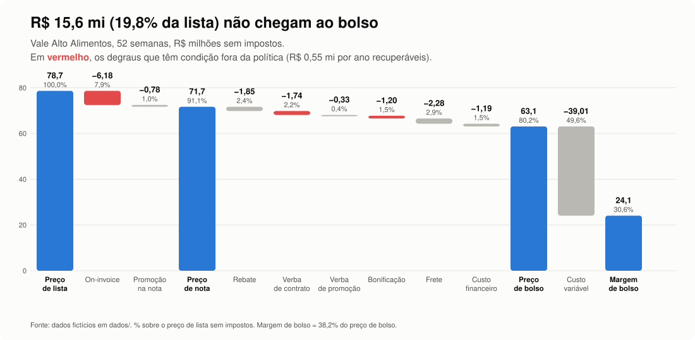
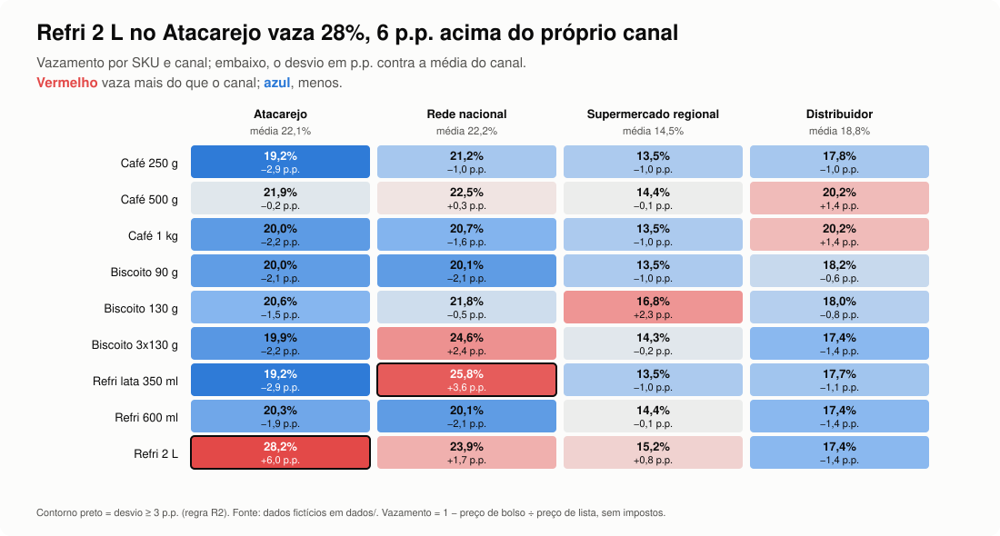

# Caso 01 · Price waterfall da Vale Alto Alimentos

> Skill: [`price-waterfall`](../skills/price-waterfall/SKILL.md) · Dados: [`dados/`](../dados/) (empresa fictícia) · 52 semanas, valores sem impostos

## O número

**R$ 15,6 mi (19,8%) da receita a preço de lista não chegam ao bolso.** Deles, **R$ 0,77 mi por ano são recuperáveis** com cinco decisões, o que representa **+3,2% de margem de bolso** (até R$ 0,90 mi se frete e prazo chegarem ao nível do melhor canal).

O maior degrau é o desconto on-invoice (7,9% da lista), puxado pelo Distribuidor (13,4%), em linha com a função dele de atender o varejo tradicional. Os vazamentos que não se justificam estão em três condições fora da política (em vermelho) e em dois custos de servir.

## Onde vaza além do canal

- **Refri 2 L no Atacarejo** vaza 28,2%, 6 p.p. acima do canal, e tem a menor margem de bolso da empresa (28,5% contra 38,2% de média). A causa é a bonificação de 7,5%, dos quais 6 p.p. vêm de um acordo de verão renovado sem revisão.
- **Refri lata na Rede nacional** fica 3,6 p.p. acima, por causa da verba de promoção (3,9% da lista do item). Antes de cortar, o retorno precisa ser medido (caso 03).
- **Biscoito 3x130 g na Rede nacional** fica 2,4 p.p. acima e tem margem de 28,6%: o enxoval de lançamento de 4% nunca foi encerrado.
- **Café 500 g e 1 kg no Distribuidor** ficam 1,4 p.p. acima: 3 p.p. a mais de on-invoice para combater uma marca regional.
- O **Supermercado regional** é o canal que menos vaza (14,5%) e o que dá mais margem de bolso (42,0%), mas paga o frete mais caro (5,0% da nota).

## Recomendações

| # | Achado | Regra | Valor/ano | Ação | Quando | Risco e como medir |
|---|---|---|---|---|---|---|
| 1 | Bonificação extra de 6% no Refri 2 L do Atacarejo | R1, R2, R3, R4 | **R$ 243 mil** | Não renovar o acordo de verão. Se o cliente exigir contrapartida, converter em desconto condicionado ao volume acima do baseline de verão | Na renovação, antes de dez/2026 | Perda de volume no verão; acompanhar o sell-out semanal contra o ano anterior |
| 2 | Frete de 5,0% no Supermercado regional | R5 | **R$ 150 mil** (teto R$ 225 mil) | Pedido mínimo e janela de entrega; levar o frete ao limite de 4% e, depois, ao nível da Rede nacional (3,5%) | Já, decisão interna | Pedidos menores migrarem para o distribuidor; medir o mix de pedidos por faixa |
| 3 | On-invoice extra de 3 p.p. no café do Distribuidor | R1 | **R$ 275 mil** | Manter só com meta de cobertura e share contra a marca regional, por 6 meses. Sem meta batida, volta à política | Próxima revisão com o distribuidor | Perder espaço para a marca regional; medir a cobertura numérica no tradicional |
| 4 | Prazo de 60 dias na Rede nacional (custo financeiro de 2,4%) | R6 | **R$ 70 mil** (teto R$ 126 mil) | Oferecer desconto por antecipação até 2% ou trocar 15 dias de prazo por ponto extra | Negociação anual | Baixo; o cliente pode recusar a troca |
| 5 | Enxoval de 4% do Biscoito 3x130 g na Rede nacional | R1, R3 | **R$ 31 mil** | Encerrar: o lançamento acabou | Já | Baixo |
| — | Verba de promoção do Refri lata na Rede nacional | R7 | — | Medir o retorno dos eventos E02 e E26 antes de decidir | Caso 03 | — |

**Total: R$ 0,77 mi por ano, ou +3,2% de margem de bolso** (teto R$ 0,90 mi). Frete e prazo são valorados contra o limite da regra; o teto usa o melhor canal comparável. Prioridade 1 (valor alto e decisão interna): nº 2. Prioridade 2 (valor alto, mas depende de negociação): nº 1 e 3. Prioridade 3: nº 4 e 5. A nº 5 é um ganho rápido.

## Ressalvas
- Os dados são fictícios e as condições, ilustrativas. Os limites das regras (R1 a R7) são pontos de partida e devem ser calibrados em cada empresa.
- O efeito de volume de cada ação não foi estimado: as recomendações 1 e 3 podem perder parte do volume, e o valor mostrado é o teto.
- O custo de servir considera só frete e prazo; armazenagem, devolução e ruptura ficam de fora.
