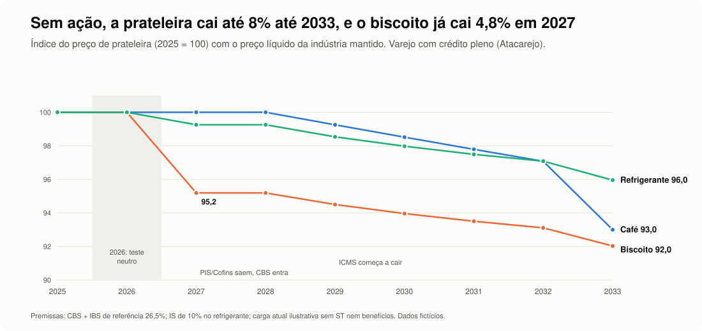
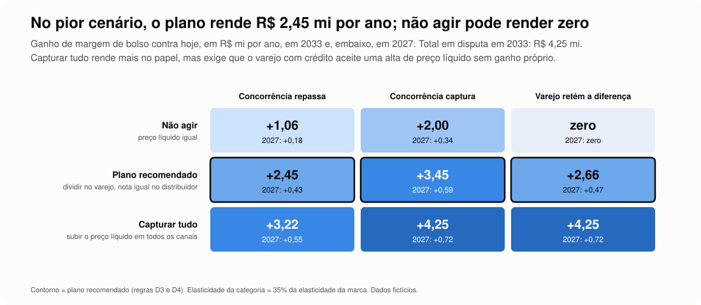
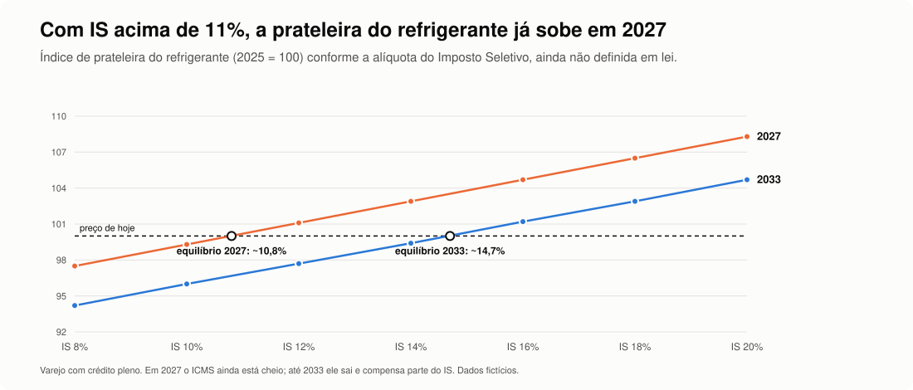

# Caso 02 · Preço da Vale Alto na reforma tributária

> Skill: [`preco-cbs-ibs`](../skills/preco-cbs-ibs/SKILL.md) · Base: preço de bolso e margem do [caso 01](01-price-waterfall.md) · Parâmetros ilustrativos, não é parecer fiscal

## O número

**Em 2033 ficam R$ 4,25 mi por ano em disputa entre a Vale Alto, o varejo e o consumidor: 17,6% da margem de bolso de hoje.** A primeira parcela vence em **janeiro de 2027**: R$ 0,72 mi, quase tudo no biscoito.

**Por que a carga cai:** hoje o biscoito paga 27,25% **por dentro** (ICMS 18% + PIS/Cofins 9,25%), o que equivale a **37,5% por fora**. Os 26,5% de CBS + IBS são cobrados por fora. Com o preço líquido igual, a prateleira cai 4,8% em 2027 (saem PIS/Cofins, entra a CBS) e 8,0% até 2033. O café, que vai para a cesta básica com alíquota zero, só sente a queda quando o ICMS começa a sair, em 2029, e chega a −7,0% em 2033.

## Quem fica com a diferença

- **Varejo com crédito pleno (Atacarejo, Rede nacional e 70% do Supermercado regional):** a reforma **não muda o custo líquido dele**, porque ele já credita ICMS e PIS/Cofins. A queda aparece no imposto de saída dele. Se ninguém negociar, **o varejista retém tudo**.
- **Revenda sem crédito (85% dos clientes do Distribuidor, no Simples):** o que conta é a nota, e a nota cai. Se a Vale Alto **mantiver a nota igual**, ela captura a diferença sem que o comprador sinta.

O plano recomendado divide a diferença com o varejo que tem crédito (α = 0,5) e mantém a nota igual no distribuidor (α = 1). Ele **nunca rende menos de R$ 2,45 mi por ano em 2033**, qualquer que seja a reação. Não agir rende de zero a R$ 2,0 mi, conforme o que os outros fizerem. Capturar tudo rende mais no papel, mas depende de o varejo com crédito aceitar uma alta de preço líquido que não traz nada para ele.

## Refrigerante: o Imposto Seletivo pode inverter o sinal

Com IS de 10%, a prateleira do refrigerante cai 4% até 2033. Com IS **acima de 10,8%**, ela **sobe já em 2027**, porque o ICMS ainda está cheio. O 2 L tem a menor margem de bolso da empresa (28,5%, caso 01), então não há espaço para absorver o IS.

## Recomendações

| # | Achado | Regra | Em disputa/ano | Ação | Quando | Risco e como medir |
|---|---|---|---|---|---|---|
| 1 | Biscoito: a prateleira cai 4,8% em 2027 | D4, D3 | **R$ 0,59 mi** a partir de 2027 | Subir o preço líquido 2,5% nos canais com crédito, mostrando que o imposto de saída do varejista cai 4,8%. No distribuidor, manter a nota igual (líquido +5,0%) | Tabela de jan/2027, negociada no 2º semestre de 2026 | Líder repassar tudo: price index mensal contra o líder, com gatilho em +3% (D5) |
| 2 | Café: o maior valor em disputa, na rampa do ICMS | D7, D4, D3 | **R$ 2,59 mi** em 2033 | Reajuste líquido anual de 2029 a 2033 acompanhando a saída do ICMS, com a mesma divisão por canal. Conferir o NCM no Anexo I | Tabelas anuais a partir de 2029 | Item da cesta tem visibilidade política; se houver pressão pública, baixar α no varejo |
| 3 | Refrigerante: o IS pode subir a prateleira | D6 | Protege R$ 0,64 mi | Fazer a conta assim que a lei ordinária do IS sair. Acima de 10,8%, responder com embalagem (lacuna entre 600 ml e 2 L, caso 04), e não com a margem do 2 L | Na publicação da alíquota | Volume do 2 L cair; acompanhar o sell-out semanal por tamanho |
| 4 | 2026 é ano de teste | D1 | — | Nenhuma mudança de preço "pela reforma". Cadastro de NCM e classificação tributária por SKU, simulação por cliente e treino do time comercial no argumento do imposto de saída | Já | Imagem, se houver aumento atribuído à reforma |
| 5 | A divisão depende do líder | D5 | — | Montar o price index mensal contra o líder por categoria e canal antes de jan/2027 | Até dez/2026 | — |

**Total do plano: de R$ 2,45 mi a R$ 3,45 mi por ano em 2033, ou +10% a +14% de margem de bolso.** Em 2027: de R$ 0,43 mi a R$ 0,59 mi.

## Sensibilidade
- **CBS + IBS de 28% em vez de 26,5%:** a queda do biscoito até 2033 vai de 8,0% para 6,9%. O café não muda (alíquota zero).
- **Carga efetiva atual:** se o ICMS efetivo do biscoito for 12% (com benefício), a queda praticamente some (−0,4%). **Esse é o primeiro número a conferir em um caso real.**
- **Imposto Seletivo:** equilíbrio em 10,8% em 2027 e em 14,7% em 2033.

## Ressalvas
- As alíquotas são de referência e estimativas de nov/2026. A alíquota do IS ainda depende de lei ordinária.
- O modelo não tem substituição tributária, benefícios estaduais, regime monofásico, split payment nem saldo credor acumulado.
- Elasticidade da categoria = 35% da elasticidade da marca; a Vale Alto é tratada como pequena perto da categoria.
