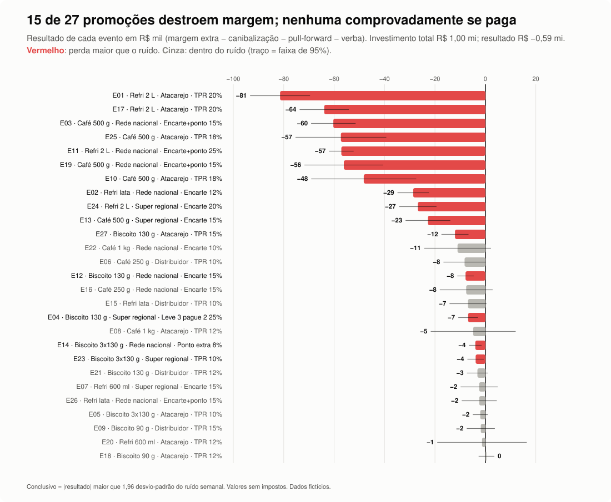
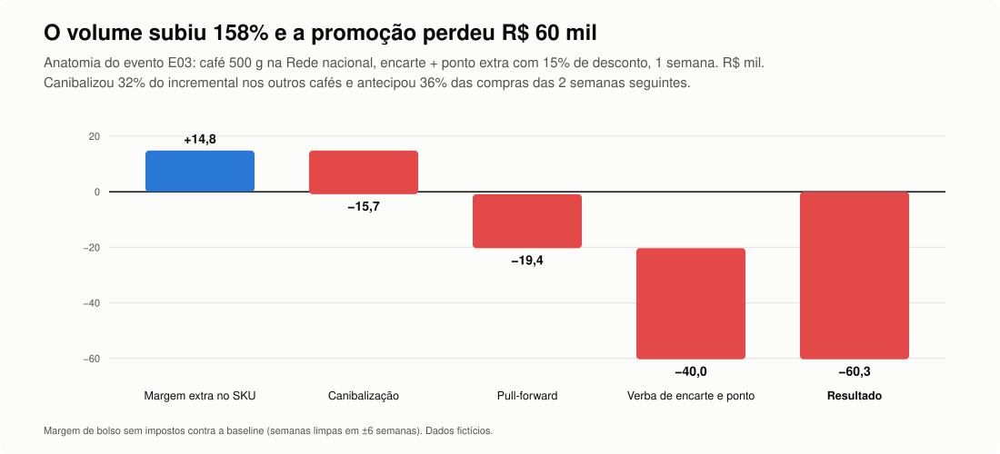

# Caso 03 · Retorno das promoções da Vale Alto

> Skill: [`retorno-promocao`](../skills/retorno-promocao/SKILL.md) · Dados: [`dados/`](../dados/) (empresa fictícia) · 27 eventos em 52 semanas, valores sem impostos

## O número

**R$ 1,00 mi investido em promoção (descontos + verbas) devolveu −R$ 0,56 mi de margem de bolso.** São 15 eventos que destroem margem com segurança estatística e somam −R$ 0,53 mi. Os outros 12 ficam dentro do ruído, inclusive os 3 que parecem se pagar.

## Por que um lift alto não basta

O E03 é o tipo de promoção que parece sucesso no relatório de volume: +158% na semana. Só que um terço do incremental saiu dos outros cafés, um terço das compras das duas semanas seguintes foi antecipado e a verba de R$ 40 mil sozinha já era maior que toda a margem extra. O mesmo evento foi repetido na semana 35 (E19) com o mesmo resultado.

## O que os 15 eventos têm em comum

- **Refri 2 L com 20 a 25% de desconto** (E01, E17, E11 e E24): −R$ 229 mil. Pull-forward médio de 35%: o consumidor estoca o 2 L. E01 e E17 são o mesmo evento repetido no verão e no inverno.
- **Café 500 g com 15 a 18%** (E03, E19, E10, E25 e E13): −R$ 239 mil. Canibalização média de 29% (o 500 g tira venda do 250 g e do 1 kg) e pull-forward de 27%. Os dois pares se repetem.
- **Verba maior que a margem extra** (E02, E27, E12, E04, E23 e E14): −R$ 62 mil. No E02, a verba de R$ 25 mil é 13 vezes a margem extra da lata.

## Recomendações

| # | Achado | Regra | Valor/ano | Ação | Quando | Risco e como medir |
|---|---|---|---|---|---|---|
| 1 | Café 500 g com 15 a 18% de desconto perde margem em todos os canais | PR1, PR3, PR2, PR7 | **R$ 239 mil** | Tirar o 500 g do calendário nesse formato. Testar 8% de desconto ou promover o 1 kg (E08, com 12%, ficou no zero a zero). Renegociar o encarte com ponto extra de R$ 40 mil para pagamento por unidade incremental | Próximo ciclo de calendário com a Rede nacional e o Atacarejo | Perder espaço no encarte para a concorrência; medir o share semanal do café na rede |
| 2 | Refri 2 L com desconto profundo é só antecipação | PR1, PR2, PR5, PR7 | **R$ 229 mil** | Sair dos 20 a 25%. Se o cliente exigir, no máximo 10%, com limite por CPF ou por pedido e fora do pico de verão | Já: o E01 cai em dezembro | Volume de verão abaixo do ano anterior; medir o sell-out semanal do 2 L |
| 3 | Verba fixa maior que a margem extra | PR4 | **R$ 31 mil** (metade dos R$ 62 mil, conservador) | Passar a verba para pay-for-performance ou trocar por TPR sem encarte | Na renegociação de cada evento | O cliente pode recusar o modelo por desempenho |
| 4 | 12 eventos inconclusivos, entre eles os 3 que parecem positivos (E20, E08, E18) | PR6 | — | Repetir E20, E08 e E18 como teste com controle (metade das lojas sem a promoção) antes de escalar; nos outros 9, não gastar tempo de reunião | Próximos 2 trimestres | — |

**Total: R$ 0,50 mi por ano de margem de bolso (+2,1%) e R$ 0,85 mi de investimento liberado** para realocar em eventos testados.

## Ligação com os outros casos
- O E02 e o E26 eram a causa do vazamento do refri lata na Rede nacional (caso 01, regra R7). O E02 destrói margem com segurança; o E26 é inconclusivo.
- A canibalização do café 500 g aponta para a escada de preço do café (caso 04).

## Ressalvas
- A baseline é a média das semanas limpas em ±6 semanas, sem modelo de sazonalidade. A faixa de ruído é conservadora.
- Sem dados de sell-out, o pull-forward mistura o estoque do consumidor com o do varejista.
- Não foram medidos o tráfego para a loja, o efeito de imagem nem as exigências contratuais de calendário, que podem justificar parte dos eventos.
