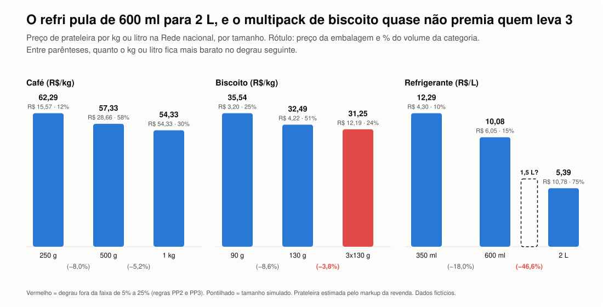
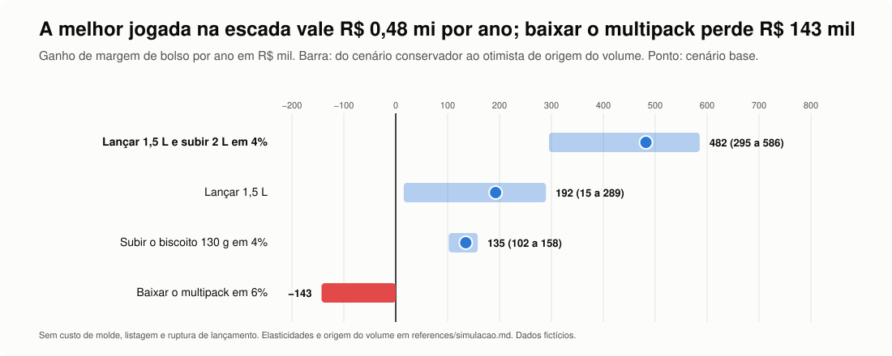

# Caso 04 · Escada de preço da Vale Alto

> Skill: [`price-pack-architecture`](../skills/price-pack-architecture/SKILL.md) · Base: margem de bolso do [caso 01](01-price-waterfall.md) · Prateleira estimada na Rede nacional

## O número

**Consertar a escada vale R$ 0,62 mi por ano no cenário base (+2,6% de margem de bolso).** A maior parte vem do refrigerante, que depende de um tamanho que paga pouco.

## O que a escada mostra

- **Refrigerante:** o 2 L tem **75% dos litros** e paga **R$ 0,80 por litro**, contra R$ 2,04 do 600 ml e R$ 2,29 da lata. Do 600 ml para o 2 L, o litro fica 46,6% mais barato e o conteúdo mais que triplica: não existe degrau no meio. Na prateleira, o 2 L já passou de R$ 9,99 (R$ 10,78). Pela regra PP6, o alerta também acende no café 250 g (R$ 15,57), no café 1 kg (R$ 54,33) e no biscoito 90 g (R$ 3,20); com preço estimado, isso pede coleta em loja antes de virar ação.
- **Biscoito:** o multipack 3x130 g é só **3,8% mais barato por kg** que o pacote avulso e ainda tem a menor margem por kg da categoria (R$ 4,88 contra R$ 5,57 do 130 g).
- **Café:** a escada é **saudável**. O kg fica 8,0% e 5,2% mais barato a cada degrau, e o 500 g concentra 58% do volume.

| Tamanho | % do volume | Margem de bolso por kg/L |
|---|---|---|
| Refri lata 350 ml | 10% | R$ 2,29 |
| Refri 600 ml | 15% | R$ 2,04 |
| Refri 2 L | 75% | **R$ 0,80** |
| Biscoito 90 g | 25% | R$ 6,27 |
| Biscoito 130 g | 51% | R$ 5,57 |
| Biscoito 3x130 g | 24% | **R$ 4,88** |
| Café 250 g | 12% | R$ 14,64 |
| Café 500 g | 58% | R$ 13,19 |
| Café 1 kg | 30% | R$ 13,11 |

## Jogadas simuladas

- **1,5 L a R$ 7,29 de lista** (cerca de R$ 9,36 na prateleira, abaixo de R$ 9,99, ou R$ 6,24 por litro): ele paga R$ 1,02 por litro, mais que o 2 L. Sozinho, rende de R$ 15 mil a R$ 289 mil, conforme de onde vier o volume. **O ganho real é o que o 1,5 L permite:** com um degrau no meio, o 2 L pode subir 4%, e a combinação rende de R$ 295 mil a R$ 586 mil, positiva até no cenário conservador.
- **Multipack:** a reação intuitiva (baixar o multipack para abrir o degrau) **perde R$ 143 mil**, porque dá desconto justo no item de menor margem. Subir o 130 g em 4% abre o degrau para 7,5% e **rende de R$ 102 mil a R$ 158 mil**.

## Recomendações

| # | Achado | Regra | Valor/ano | Ação | Quando | Risco e como medir |
|---|---|---|---|---|---|---|
| 1 | O 2 L concentra o volume, paga pouco e não tem degrau abaixo | PP4, PP3, PP5, PP6 | **R$ 482 mil** (295 a 586) | Lançar o 1,5 L a R$ 7,29 de lista e, com ele na gôndola, subir o 2 L em 4% | Lançamento no 1º semestre de 2027; o reajuste do 2 L 8 a 12 semanas depois | O 1,5 L tirar mais do 600 ml que o previsto: mix em litros por tamanho, semanal. Se o IS vier acima de 10,8% (caso 02), alinhar os +4% com a entrada do IS |
| 2 | O multipack não premia quem leva 3 | PP2 | **R$ 135 mil** (102 a 158) | Subir o biscoito 130 g em 4%. Não baixar o multipack | Próxima tabela | Perda de volume do 130 g maior que a prevista: volume em kg da categoria, mensal |
| 3 | A escada do café está saudável | — | — | Manter. Na promoção, usar o 1 kg, que canibaliza menos que o 500 g (caso 03) | Próximo calendário | — |

**Total: R$ 0,62 mi por ano no cenário base (+2,6% de margem de bolso), de R$ 0,40 mi a R$ 0,74 mi entre os cenários.**

## Ressalvas
- A prateleira é estimada pelo markup da revenda. Num caso real, use o preço coletado em loja.
- A origem do volume segue faixas fixas (ver [`simulacao.md`](../skills/price-pack-architecture/references/simulacao.md)). Com dados de painel, estime a substituição entre tamanhos.
- Não entram custo de molde e de linha, taxa de listagem, ruptura de lançamento nem o tempo até o volume estabilizar.
