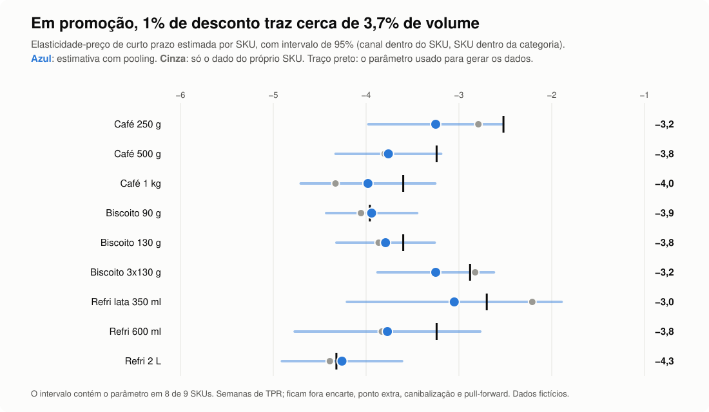

# Caso 05 · Elasticidade estimada da Vale Alto

> Skill: [`elasticidade-preco`](../skills/elasticidade-preco/SKILL.md) · Código: [`scripts/estimar_elasticidade.py`](../scripts/estimar_elasticidade.py) · Resultado: [`dados/elasticidade_estimada.csv`](../dados/elasticidade_estimada.csv)

## O número

**Em promoção, cada 1% de desconto traz cerca de 3,7% de volume** (média das três categorias, de −3,66 a −3,70). O modelo recupera o parâmetro usado para gerar os dados em **8 de 9 SKUs**, com erro médio de 0,35.

## O que o pooling resolve
- Só 12 dos 36 pares SKU × canal têm promoção com desconto puro. Nos outros 24, o único movimento de preço é o reajuste de lista, que se confunde com o mês: **estimar ali daria número sem sentido**.
- Esses pares herdam a média da categoria, com intervalo mais largo. É melhor dizer "não sei, mas a categoria sugere −3,7 ± 0,8" do que inventar.
- Na primeira versão, puxar tudo direto para a média da categoria "achatou" o multipack, que é menos elástico, e 3 de 12 intervalos erraram. Com dois níveis (canal dentro do SKU, SKU dentro da categoria), o multipack ficou em −3,2 e a cobertura subiu para 8 de 9. É a mesma lógica de decompor a sensibilidade por tamanho e embalagem.

## Ligação com os outros casos
- **Promoção (caso 03):** com elasticidade de −3,7, 15% de desconto gera cerca de **83% de volume**. Com margem de bolso de 38%, o empate antes da verba pede cerca de 65%. Ou seja, o desconto em si até se paga; quem destrói a promoção são a canibalização, o pull-forward e a verba.
- **Reforma (caso 02):** o modelo usa a elasticidade da categoria como 35% da elasticidade da marca. Com a estimativa, essa premissa pode ser calibrada.
- **Escada de preço (caso 04):** o multipack é o menos elástico do biscoito (−3,2), o que reforça não baixar o preço dele.

## Ressalvas
- Dados fictícios: aqui é possível conferir contra o parâmetro verdadeiro, coisa que não existe num caso real. Nele, a validação é um teste de preço.
- É elasticidade promocional de curto prazo; a de reajuste permanente é menor.
- 52 semanas não separam sazonalidade de ano a ano; o efeito do mês é uma aproximação.
