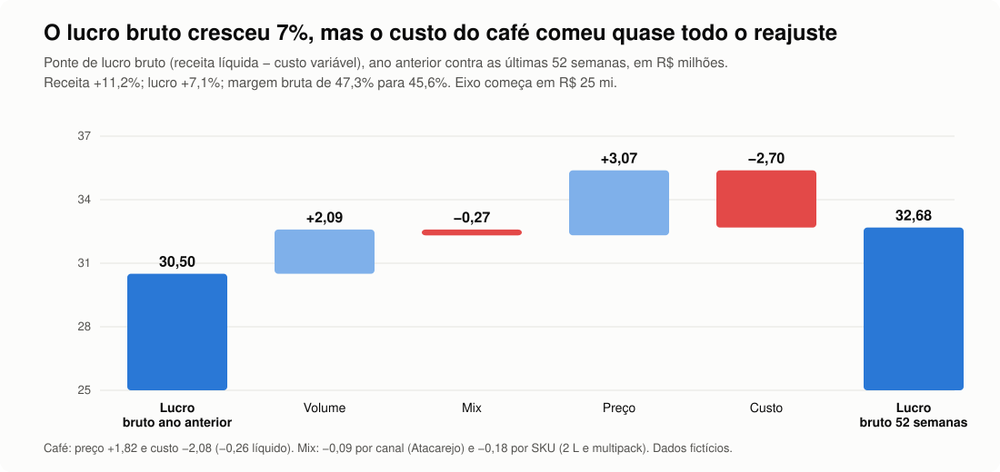
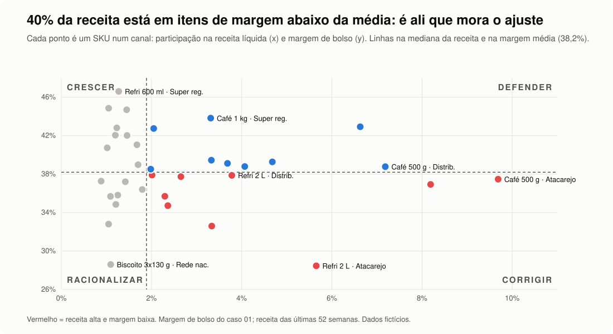

# Caso 06 · Mix e rentabilidade da Vale Alto

> Skill: [`mix-rentabilidade`](../skills/mix-rentabilidade/SKILL.md) · Dados: [`dados/ano_anterior.csv`](../dados/ano_anterior.csv) contra as 52 semanas de vendas · Receita líquida e lucro bruto (receita − custo variável)

## O número

**A receita líquida cresceu 11,2%, mas o lucro bruto só 7,1%, e a margem caiu de 47,3% para 45,6%.** O reajuste de preço trouxe R$ 3,07 mi, e a alta de custo levou R$ 2,70 mi de volta. No café, o custo subiu mais que o preço: **−R$ 0,26 mi líquidos**.

## O que a ponte mostra
- **Volume +R$ 2,09 mi:** a empresa vendeu 6,8% mais unidades.
- **Mix −R$ 0,27 mi:** o crescimento veio do que paga menos. São −R$ 0,09 mi de **mix de canal** (o Atacarejo cresceu 14%) e −R$ 0,18 mi de **mix de SKU** (o 2 L e o multipack cresceram acima da média).
- **Preço contra custo, por categoria:**

| Categoria | Preço | Custo | Líquido |
|---|---|---|---|
| Café | +R$ 1,82 mi | −R$ 2,08 mi | **−R$ 0,26 mi** |
| Biscoito | +R$ 0,43 mi | −R$ 0,22 mi | +R$ 0,21 mi |
| Refrigerante | +R$ 0,83 mi | −R$ 0,41 mi | +R$ 0,42 mi |

O café teve 11% de inflação de custo e 6% de reajuste de lista, e parte do reajuste se perdeu em desconto.

## Onde agir: matriz receita × margem

| Quadrante | Itens | Receita | Leitura |
|---|---|---|---|
| Corrigir (receita alta, margem baixa) | 9 | 40% | Café 500 g e refri 2 L no Atacarejo e na Rede nacional: as alavancas são condição comercial (caso 01) e escada de preço (caso 04) |
| Defender | 9 | 37% | Café 1 kg e café 500 g no Supermercado regional e no Distribuidor |
| Crescer (receita baixa, margem alta) | 9 | 12% | Lata e 600 ml: falta distribuição (caso 07) |
| Racionalizar | 9 | 11% | Multipack e biscoito 90 g em canais de giro baixo: testar o corte (caso 07) |

**Curva ABC, receita contra lucro:** 5 dos 36 itens mudam de classe. A lata no Atacarejo sobe de B para A em lucro (48% de margem), e o multipack no Distribuidor e na Rede nacional cai de B para C. Volume que não paga a conta.

## Recomendações

| # | Achado | Valor/ano | Ação | Quando | Risco |
|---|---|---|---|---|---|
| 1 | O preço do café não cobriu a alta do custo | **R$ 0,26 mi** | Reajuste líquido de **+0,7%** no café, de preferência recuperando desconto e não mexendo na lista | Próxima tabela | Elasticidade promocional alta (−3,7, caso 05): fazer pela redução de desconto, não pela prateleira |
| 2 | 40% da receita está no quadrante Corrigir | — | As ações dos casos 01 e 04 atacam exatamente esses itens | Ver casos 01 e 04 | — |
| 3 | O mix piora com o crescimento do Atacarejo | — | Política de canal: condições do Atacarejo atreladas a mix (lata e 600 ml, não só 2 L) | Negociação anual | Perder volume no canal que mais cresce |

## Ressalvas
- O ano anterior é fictício e foi gerado a partir do ano atual com crescimentos e inflação de custo definidos (ver `scripts/gerar_dados_mix_sortimento.py`).
- O lucro bruto aqui é antes das verbas fora da nota; a margem de bolso da matriz vem do caso 01.
