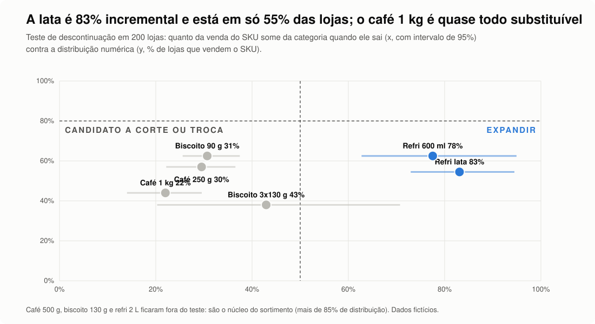

# Caso 07 · Sortimento da Vale Alto

> Skill: [`sortimento`](../skills/sortimento/SKILL.md) · Dados: [`lojas.csv`](../dados/lojas.csv), [`sellout_lojas.csv`](../dados/sellout_lojas.csv) e [`testes_descontinuacao.csv`](../dados/testes_descontinuacao.csv): 200 lojas, 12 meses, com teste de descontinuação a partir de junho

## O número

**A lata é 83% incremental e está em só 55% das lojas.** Levar a lata e o 600 ml a 80% de distribuição em cada canal vale **até R$ 0,57 mi por ano** em margem de bolso. No outro extremo, o café 1 kg é 78% substituível: quando ele sai, quase toda a venda vai para o 500 g.

## Como foi medido
Em cerca de 30% das lojas que tinham seis SKUs, o SKU saiu em junho. A **diferença em diferenças** compara a categoria nessas lojas, antes e depois, com as lojas que mantiveram o SKU (e sem nenhuma outra saída na categoria). Assim a sazonalidade e o perfil da loja saem da conta. O intervalo vem de bootstrap das lojas.

| SKU | Incrementalidade | Distribuição numérica | Tradicional |
|---|---|---|---|
| Refri lata 350 ml | 83% (73-94) | 55% | 36% |
| Refri 600 ml | 78% (63-95) | 62% | 60% |
| Biscoito 3x130 g | 43% (20-71) | 38% | 9% |
| Biscoito 90 g | 31% (26-37) | 62% | 60% |
| Café 250 g | 30% (22-37) | 57% | 47% |
| Café 1 kg | 22% (14-30) | 44% | 16% |

A ordem bate com o comportamento esperado da categoria: refrigerante pequeno é ocasião de consumo própria (tomar na hora), enquanto café e biscoito são o mesmo produto em outro tamanho. O multipack tem intervalo largo porque poucas lojas o tinham: regra S4, repetir o teste.

## Recomendações

| # | Achado | Regra | Valor/ano | Ação | Quando | Risco |
|---|---|---|---|---|---|---|
| 1 | A lata é muito incremental e falta em 45% das lojas, 64% no tradicional | S1 | **R$ 0,33 mi** | Levar a lata a 80% de distribuição em cada canal, começando pelo tradicional (via distribuidor) e pelo super regional | Próximo ciclo de distribuição | Refrigeração e espaço na loja pequena |
| 2 | O 600 ml também é incremental | S1 | **R$ 0,24 mi** | A mesma expansão, depois da lata (os dois disputam parte da demanda: o valor somado é teto) | Depois da nº 1 | Canibalização entre lata e 600 ml |
| 3 | O multipack quase não vende no tradicional e no super regional | S2, S3 | custa R$ 55 mil | **Trocar** o multipack pela lata nessas lojas: o espaço vai para o SKU que traz venda nova | Junto com a nº 1 | Cliente que pede o multipack |
| 4 | O café 1 kg é 78% substituível | S2 | custaria até R$ 0,21 mi | Não cortar por ora: a margem por unidade é alta. Só sair do tradicional se o espaço for para a lata | Revisão semestral | — |

**Total: até R$ 0,57 mi por ano.** A troca do multipack custa R$ 55 mil e é coberta pela lata que entra no lugar. O painel de 200 lojas foi extrapolado para o volume da empresa (fator 2,3).

## Ressalvas
- Dados fictícios. A transferência verdadeira de cada SKU está no gerador; o teste recupera a ordem, e os pontos têm erro de alguns pontos percentuais.
- Expansão de distribuição custa (listagem, refrigeração, força de vendas); o valor mostrado é a margem bruta da venda nova.
- Café 500 g, biscoito 130 g e refri 2 L ficaram fora do teste: são o núcleo do sortimento (regra S5).
